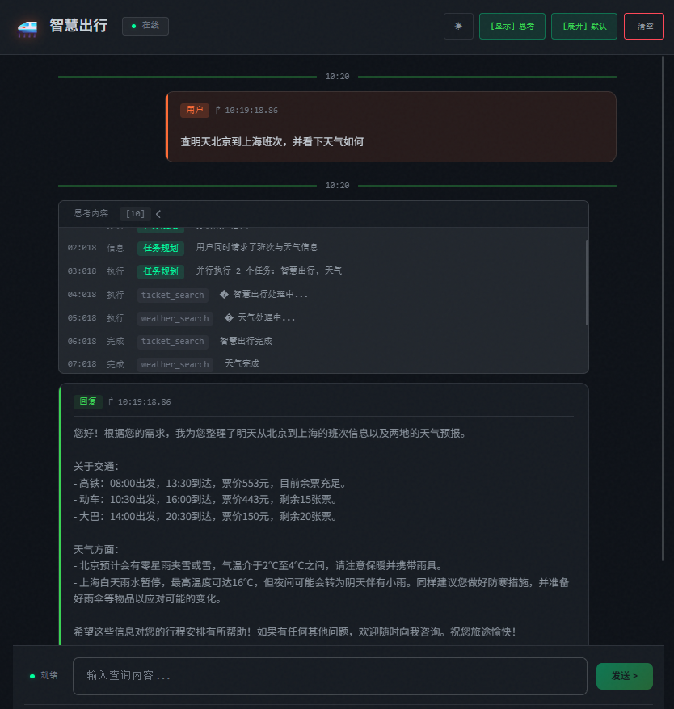
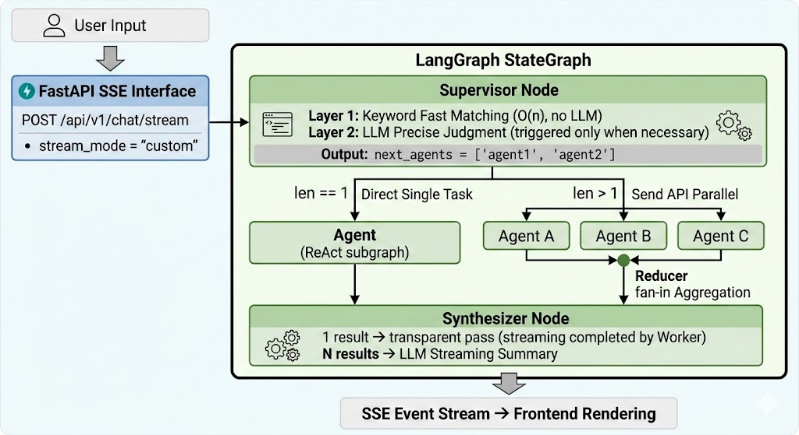

# 基于 LangGraph 的多 Agent 协作系统实战：从架构设计到并行调度

> **项目地址**：[https://github.com/sslovett/planMultiAgent](https://github.com/sslovett/planMultiAgent)
>
> **技术栈**：FastAPI / LangGraph / LangChain / React / TypeScript / Vite
>
> **关键词**：LangGraph、多 Agent 协作、Send API 并行 fan-out、ReAct Agent、SSE 流式输出、Supervisor 路由

---

## 一、为什么需要多 Agent 协作？

当我们用大模型构建一个旅行助手时，用户的问题往往是复杂的：

> "帮我查一下明天北京到上海的高铁，顺便看看上海天气"

这一句话里同时包含了**班次查询**和**天气查询**两个独立任务。如果用单一 Agent 串行处理，要么让一个 Agent 承担所有能力（Prompt 膨胀、工具冲突），要么串行调用多个工具（延迟叠加）。

更合理的做法是：让专业的 Agent 做专业的事，让它们并行执行，最后汇总结果。

这正是 **Supervisor + Worker Agent 并行协作模式** 的核心思路。本项目基于 LangGraph 实现了这一架构，下面完整分享从设计到落地的全过程。

---

## 二、系统功能一览

### 2.1 核心功能

| 功能模块 | Agent | 描述 | 示例问句 |
|---------|-------|------|---------|
| 班次查询 | `ticket_search` | 查询火车、高铁、航班班次信息 | "查一下明天北京到上海的高铁" |
| 天气查询 | `weather_search` | 查询城市实时天气 | "上海今天天气怎么样" |
| 政策咨询 | `kb_search` | 退票改签规则、票价政策等知识库 RAG | "高铁改签要收手续费吗" |
| 闲聊 | `chitchat` | 自然语言闲聊、引导使用 | "你好，你能帮我做什么" |
| 多任务并行 | 多 Agent 协作 | 自动识别多意图，Send API 并行执行 | "查北京到上海的班次，顺便看看上海天气" |



### 2.2 思考链可视化

系统的一大特色是**终端风格的思考过程实时展示**。前端以类似日志终端的 UI 实时渲染每一步思考，包括 Agent 名称标签、操作类型标识、流式光标动画等。用户能清楚看到：

```
01:032  分析  规划    分析用户意图...
02:156  完成  规划    识别到班次查询+天气查询需求
03:201  规划  规划    并行执行 2 个任务：智慧出行, 天气
04:350  执行  出行    智慧出行处理中...
05:355  执行  天气    天气处理中...
06:892  完成  出行    智慧出行完成
07:910  完成  天气    天气完成
08:920  执行  汇总    汇总 2 个任务结果
```

这种设计参考了 Claude 的 Thinking 展示方式——用户不仅看到最终结果，还能看到系统"是怎么想的"。

---

## 三、架构设计

### 3.1 整体数据流



```
用户输入
  │
  ▼
┌──────────────────────────────────────────────────┐
│                FastAPI SSE 接口                    │
│           POST /api/v1/chat/stream                │
│           stream_mode = "custom"                  │
└──────────────────────┬───────────────────────────┘
                       │
                       ▼
┌──────────────────────────────────────────────────┐
│              LangGraph StateGraph                  │
│                                                    │
│   ┌────────────────────────────────────────────┐ │
│   │            Supervisor Node                   │ │
│   │                                              │ │
│   │   第一层：关键词快速匹配（O(n)，无 LLM）      │ │
│   │   第二层：LLM 精确判断（仅必要时触发）        │ │
│   │                                              │ │
│   │   输出：next_agents = ["agent1", "agent2"]   │ │
│   └──────┬──────────────────────────┬────────────┘ │
│          │                          │              │
│    len == 1                    len > 1             │
│   单任务直连               Send API 并行           │
│          │                 ┌────┬────┐             │
│          ▼                 ▼    ▼    ▼             │
│    ┌──────────┐     ┌─────┐ ┌─────┐ ┌─────┐      │
│    │  Agent   │     │Agent│ │Agent│ │Agent│       │
│    │  (ReAct  │     │  A  │ │  B  │ │  C  │       │
│    │  子图)   │     └──┬──┘ └──┬──┘ └──┬──┘       │
│    └────┬─────┘        │       │       │           │
│         │              └───────┼───────┘           │
│         │              Reducer fan-in 聚合          │
│         │                      │                   │
│         ▼                      ▼                   │
│   ┌────────────────────────────────────────────┐  │
│   │           Synthesizer Node                   │  │
│   │                                              │  │
│   │   1 个结果 → 透传（流式已由 Worker 完成）     │  │
│   │   N 个结果 → LLM 流式汇总                    │  │
│   └──────────────────────────────────────────────┘  │
└──────────────────────────────────────────────────┘
                       │
                       ▼
              SSE 事件流 → 前端渲染
```

### 3.2 三层节点职责

| 节点 | 职责 | 输入 | 输出 |
|------|------|------|------|
| **Supervisor** | 意图识别、任务分解、路由决策 | 用户消息 | `next_agents` 列表 |
| **Worker Agent** | 执行具体任务（ReAct 子图） | 用户消息 + 工具 | `agent_outputs` 结果 |
| **Synthesizer** | 结果聚合与流式输出 | 所有 `agent_outputs` | `final_response` |

### 3.3 项目目录结构

```
planMultiAgent/
├── backend/
│   └── app/
│       ├── agents/
│       │   ├── nodes/
│       │   │   ├── supervisor.py          # Supervisor 节点：双层路由
│       │   │   └── synthesizer.py         # Synthesizer 节点：多结果汇总
│       │   └── tools/
│       │       ├── registry.py            # ToolRegistry 工具注册中心
│       │       ├── __init__.py            # 工具自动注册入口
│       │       ├── ticket_tool.py         # 班次查询工具
│       │       ├── weather_tool.py        # 天气查询工具
│       │       ├── kb_tool.py             # 知识库检索工具
│       │       └── chitchat_tool.py       # 闲聊工具
│       ├── graph/
│       │   ├── state.py                   # AgentState（Annotated reducer）
│       │   ├── agents.py                  # create_react_agent 工厂
│       │   └── langgraph_workflow.py      # 工作流编译、路由函数
│       ├── utils/
│       │   ├── message_helpers.py         # get_writer()、SSE 构造、3.10 兼容
│       │   ├── llm_helper.py             # call_llm / call_llm_stream 统一接口
│       │   └── llm_client.py             # OpenAI 兼容客户端
│       ├── services/                      # 外部服务调用层
│       ├── vectors/                       # 向量数据库适配层（Qdrant/ES）
│       ├── api/
│       │   └── routes.py                 # SSE 流式接口
│       ├── config.py                      # pydantic-settings 配置
│       └── main.py                        # FastAPI 入口 + lifespan
├── frontend/
│   └── src/
│       ├── components/
│       │   ├── ChatInterface.tsx          # 主界面
│       │   ├── ThinkingChain.tsx          # 终端风格思考链组件
│       │   ├── MessageList.tsx            # 消息列表
│       │   ├── MessageItem.tsx            # 消息气泡
│       │   └── InputBox.tsx               # 输入框
│       ├── api/chat.ts                    # SSE 流解析 + 回调分发
│       └── store/chatStore.ts             # Zustand 状态管理
└── README.md
```

---

## 四、核心技术深度解析

### 4.1 AgentState：自定义 Reducer 解决并行 fan-in 难题

多 Agent 并行执行时最棘手的问题是：**多个节点同时写同一个 state 字段，如何避免覆盖？**

LangGraph 的解决方案是 `Annotated` + Reducer 函数。本项目为 `agent_outputs` 字段设计了一个自定义 Reducer：

```python
# backend/app/graph/state.py

def _reset_on_empty(existing: list, new: list) -> list:
    """
    自定义列表 Reducer：空列表重置，非空追加

    - Supervisor 传入 [] → 清除上一轮旧结果（每轮重置）
    - Agent 传入 [{...}] → 追加到列表（并行 fan-in 安全）
    """
    if not new:
        return []
    return existing + new


class AgentState(TypedDict):
    # LangGraph 原生 reducer，自动管理多轮对话历史
    messages: Annotated[Sequence[BaseMessage], add_messages]

    # 自定义 reducer，支持并行安全聚合 + 每轮自动重置
    agent_outputs: Annotated[list, _reset_on_empty]

    # Supervisor 输出的路由信息
    next_agents: List[str]
    collaboration_mode: str    # "single" | "parallel"

    # 各 Agent 业务上下文（Supervisor 动态填充）
    ticket_context: dict
    weather_context: dict
    consultation_context: dict

    # 最终输出
    final_response: str
```

Supervisor 每轮开始时返回 `agent_outputs: []`，Reducer 检测到空列表就清除旧数据；Worker Agent 各自返回 `[{...}]`，Reducer 执行 `existing + new` 追加合并。LangGraph 保证 Reducer 操作的原子性，不存在并发写冲突。

这比手动加锁或用队列收集结果要优雅得多——**利用框架的 Reducer 机制，把并发问题消化在状态定义层**。

### 4.2 Supervisor 双层路由：关键词快速通道 + LLM 精确补充

路由策略直接影响系统的**响应速度**和**意图识别准确率**。

纯 LLM 路由准确但慢（每次都要调用 LLM），纯关键词路由快但死板（语义模糊时容易误判）。项目采用了"两层漏斗"设计：

```python
# backend/app/agents/nodes/supervisor.py

def _analyze_task(query: str, messages: list, state: AgentState) -> dict:
    """
    双层路由策略：
    第一层：关键词快速匹配（O(n)，零 LLM 开销）
    第二层：LLM 精确判断（仅在多工具冲突或无匹配时触发）
    """
    registry = get_tool_registry()
    all_tools = registry.get_all()

    # ====== 第一层：关键词匹配 ======
    matched_tools = registry.match_by_keywords(query)

    if matched_tools:
        # 唯一匹配 → 直接选定
        if len(matched_tools) == 1:
            tool_name = matched_tools[0][0]
            return {"mode": "single", "subtasks": [{"agent": tool_name, ...}]}

        # 最高优先级明显领先（priority 数值越小越高）
        if matched_tools[0][1] < matched_tools[1][1]:
            return {"mode": "single", "subtasks": [...]}

        # 多工具同优先级 → 需要 LLM 判断是否并行
        return _analyze_with_llm(query, messages, all_tools,
                                 matched_tools=same_priority_tools)

    # ====== 第二层：LLM 分析 ======
    return _analyze_with_llm(query, messages, all_tools)
```

**性能对比**：

| 场景 | 路由方式 | 额外延迟 | 示例 |
|------|---------|---------|------|
| "查北京到上海高铁" | 关键词直连 | **0ms** | 命中"高铁"关键词 → `ticket_search` |
| "上海天气" | 关键词直连 | **0ms** | 命中"天气"关键词 → `weather_search` |
| "查个班次顺便看天气" | LLM 判断并行 | ~500ms | 同优先级冲突 → LLM 决定 parallel |
| "这个可以退吗" | LLM 兜底分析 | ~500ms | 无关键词命中 → LLM 分析意图 |

80% 以上的日常请求都能通过第一层关键词匹配直接路由，**省去了不必要的 LLM 调用**。

### 4.3 Send API：真正的并行 fan-out

这是本项目的核心亮点。LangGraph 的 `Send API` 可以在条件路由中返回 `Send` 对象列表，让多个节点真正并发执行（而非串行调度）。

```python
# backend/app/graph/langgraph_workflow.py

from langgraph.types import Send
from langgraph.graph import StateGraph, END

def route_after_supervisor(state: AgentState):
    """Supervisor → Agent 的路由函数"""
    next_agents = state.get("next_agents", [])

    if not next_agents:
        return END                    # 无任务 → 结束

    if len(next_agents) == 1:
        return next_agents[0]         # 单任务 → 直接路由

    # 多任务 → Send API 并行 fan-out
    return [Send(agent, state) for agent in next_agents]
```

**工作流编译**——把所有节点和边组装起来：

```python
def create_workflow() -> StateGraph:
    agents = create_worker_agents()  # 从 ToolRegistry 动态创建所有 ReAct Agent
    workflow = StateGraph(AgentState)

    # 三类节点
    workflow.add_node("supervisor", supervisor_node)
    for name, compiled_agent in agents.items():
        workflow.add_node(name, _make_agent_node(name, compiled_agent))
    workflow.add_node("synthesizer", synthesizer_node)

    # 边
    workflow.set_entry_point("supervisor")
    route_map = {name: name for name in agents.keys()}
    route_map[END] = END
    workflow.add_conditional_edges("supervisor", route_after_supervisor, route_map)
    for name in agents.keys():
        workflow.add_edge(name, "synthesizer")  # 所有 Agent → Synthesizer
    workflow.add_edge("synthesizer", END)

    return workflow


def compile_workflow():
    """编译 + MemorySaver checkpointer（会话持久化）"""
    workflow = create_workflow()
    checkpointer = MemorySaver()
    return workflow.compile(checkpointer=checkpointer)
```

编译后的工作流图结构如下：

```
START → supervisor → [ticket_search, weather_search, kb_search, chitchat] → synthesizer → END
            │                        ↑ Send 并行 fan-out
            │                        ↓ Reducer fan-in 聚合
            └── END（无任务时直接结束）
```

### 4.4 Worker Agent：ReAct 子图 + 流式双模态

每个 Worker Agent 都是一个 `create_react_agent` 编译出的独立子图，内置 Reason → Act → Observe 循环。Agent 包装节点根据是否为单 Agent 场景，选择不同的输出策略：

```python
# backend/app/graph/langgraph_workflow.py

def _make_agent_node(agent_name: str, compiled_agent):
    """创建 Agent 包装节点"""

    async def node_fn(state: AgentState, config: RunnableConfig) -> dict:
        writer = get_writer(config)
        is_single_agent = len(state.get("next_agents", [])) == 1

        if is_single_agent:
            # 单 Agent：astream_events 捕获子图内部 LLM token，逐个推送到前端
            response_text = await _stream_agent(compiled_agent, state, writer, ...)
        else:
            # 多 Agent：ainvoke 收集完整结果，交给 Synthesizer 统一汇总
            result = await compiled_agent.ainvoke({"messages": state["messages"]})
            response_text = _extract_response(result)

        return {
            "messages": [AIMessage(content=response_text, name=agent_name)],
            "agent_outputs": [{
                "agent_name": agent_name,
                "success": True,
                "response": response_text,
            }],
        }

    return node_fn
```

**为什么要区分单/多 Agent 输出策略？**

- **单 Agent**：用户只等一个任务，应该尽快看到第一个 token → 用 `astream_events` 逐 token 流式推送。
- **多 Agent**：多个任务并行执行，每个结果都只是片段 → 用 `ainvoke` 收集完整结果，由 Synthesizer 统一汇总后再流式输出，避免多路结果交错。

**流式输出的关键实现**——从 ReAct 子图中捕获 LLM 的 token 流：

```python
async def _stream_agent(compiled_agent, state, writer, agent_name, display_name):
    """通过 astream_events 捕获 ReAct 子图内部的 LLM token"""
    response_text = ""

    async for event in compiled_agent.astream_events(
        {"messages": state["messages"]}, version="v2"
    ):
        if event["event"] == "on_chat_model_stream":
            chunk = event["data"]["chunk"]
            content = chunk.content or ""
            # 关键：过滤掉工具调用 token，只推送最终回复内容
            if content and not getattr(chunk, "tool_call_chunks", []):
                response_text += content
                writer({"type": "content_stream", "block": {
                    "delta": content,
                    "accumulated": response_text,
                }})

    return response_text
```

> 这里有一个容易踩的坑：`on_chat_model_stream` 事件不仅包含最终回复的 token，也包含 tool call 的参数 token。如果不过滤 `tool_call_chunks`，前端会收到一堆乱码 JSON。

### 4.5 Synthesizer：智能汇总策略

Synthesizer 根据结果数量采取不同策略：

```python
# backend/app/agents/nodes/synthesizer.py

async def synthesizer_node(state: AgentState, config: RunnableConfig) -> dict:
    writer = get_writer(config)
    agent_outputs = state.get("agent_outputs", [])

    if not agent_outputs:
        return {}

    # 单结果 → 直接透传（Agent wrapper 已完成流式推送）
    if len(agent_outputs) == 1:
        return {"final_response": agent_outputs[0]["response"]}

    # 多结果 → LLM 流式汇总
    prompt = f"""汇总以下 {len(agent_outputs)} 个 Agent 的执行结果..."""

    response = ""
    async for token in call_llm_stream(prompt=prompt, ...):
        response += token
        writer({"type": "content_stream", "block": {
            "delta": token,
            "accumulated": response,
        }})

    return {
        "messages": [AIMessage(content=response)],
        "final_response": response,
    }
```

当 Synthesizer 遇到 LLM 调用失败时，会自动降级为**简单拼接**模式——把各 Agent 结果按顺序拼接后一次性推送，确保用户始终能得到响应。

### 4.6 ToolRegistry：插件化的工具注册中心

所有工具的元数据（名称、关键词、优先级、上下文映射）统一由 `ToolRegistry` 管理。工作流代码不硬编码任何工具名称，完全通过注册中心动态发现。

```python
# backend/app/agents/tools/registry.py

class ToolConfig(BaseModel):
    name: str                           # 技术名称
    display_name: str                   # 前端显示名称
    description: str                    # 工具描述
    keywords: List[str]                 # 关键词列表（第一层路由用）
    priority: int = 3                   # 优先级（1=最高）
    tool_class: Type[BaseTool]          # LangChain 工具类
    required_params: List[str] = []     # 必需参数列表
    context_field: Optional[str]        # 对应 AgentState 中的上下文字段
    context_description: Optional[str]  # 上下文描述模板


class ToolRegistry:
    def register(self, name, display_name, keywords, tool_class, priority, ...): ...
    def match_by_keywords(self, query) -> List[tuple[str, int]]: ...
    def get_tool_instance(self, name) -> BaseTool: ...
```

**注册示例**：

```python
# backend/app/agents/tools/__init__.py

registry.register(
    name="ticket_search",
    display_name="智慧出行",
    description="班次查询：查询车次、班次、出行计划",
    keywords=["火车", "班次", "车票", "高铁", "飞机", "航班", "买票", "订票"],
    tool_class=TicketSearchTool,
    priority=2,
    requires_params=True,
    required_params=["departure", "destination"],
    context_field="ticket_context",
    context_description="用户查询了从 {departure} 到 {destination} 的班次"
)
```

`context_field` 和 `context_description` 的设计使得 Supervisor 能**自动将解析出的参数填入 AgentState 对应的上下文字段**，供 LLM 在后续对话中引用（例如"目的地天气"自动关联到之前查过的目的地城市）。

### 4.7 SSE 流式协议设计

#### 后端：`stream_mode="custom"` 统一推送

LangGraph 提供了多种 stream_mode（`values`、`updates`、`messages`、`custom`）。本项目选择 `custom` 模式：所有事件通过 `get_stream_writer()` 手动推送，精确控制每一个 SSE 事件的时机和内容。

```python
# backend/app/api/routes.py

@router.post("/chat/stream")
async def chat_stream(request_body: ChatRequest, request: Request):
    workflow = get_workflow()
    session_id = request_body.session_id or str(uuid.uuid4())
    config = {"configurable": {"thread_id": session_id}}

    async def stream_output():
        yield sse_event("session_id", {"session_id": session_id})
        yield sse_event("thinking_start")

        async for payload in workflow.astream(
            input_state, config=config, stream_mode="custom"
        ):
            event_type = payload.get("type", "")
            if event_type == "thinking_stream":
                yield sse_event("thinking_stream", payload)
            elif event_type == "content_stream":
                yield sse_event("content_stream", {
                    "delta": payload["block"]["delta"],
                    "accumulated": payload["block"]["accumulated"],
                })

        yield sse_event("thinking_end")
        yield sse_event("response_end", {"content": accumulated_content})

    return StreamingResponse(stream_output(), media_type="text/event-stream")
```

#### SSE 事件协议

| 事件类型 | 触发时机 | 关键字段 |
|---------|---------|---------|
| `session_id` | 请求开始 | `session_id` |
| `thinking_start` | 思考链启动 | — |
| `thinking_stream` | 每个思考步骤 | `content`, `agent`, `agent_display`, `is_streaming` |
| `content_stream` | 回复 token | `delta`（增量）, `accumulated`（累积） |
| `thinking_end` | 思考链结束 | — |
| `response_end` | 完整响应结束 | `content`, `needs_input` |

#### 前端：SSE 流解析与回调分发

前端通过 `fetch` + `ReadableStream` 解析 SSE 事件流，按事件类型分发到不同回调：

```typescript
// frontend/src/api/chat.ts

export const chatApi = {
  sendMessageStream: async (request: ChatRequest, callbacks: StreamCallbacks) => {
    const response = await fetch(`${API_BASE_URL}/chat/stream`, {
      method: 'POST',
      headers: { 'Content-Type': 'application/json', 'Accept': 'text/event-stream' },
      body: JSON.stringify(request),
    });

    const reader = response.body?.getReader();
    // 解析 SSE 事件 → 按 type 分发到 onThinking / onContent / onResponseEnd
    await parseSSEReader(reader, callbacks);
  },
};
```

前端 `ThinkingChain` 组件以终端日志风格渲染思考过程，每个思考块包含：
- **时间戳**（`01:032` 格式）
- **操作类型标签**（分析 / 搜索 / 执行 / 完成）
- **Agent 标签**（彩色标识不同 Agent）
- **流式光标**（正在思考时闪烁）

### 4.8 Python 3.10 contextvars 兼容方案

这是开发过程中耗时最长的一个技术难题。

**问题**：LangGraph 的 `get_stream_writer()` 依赖 Python 的 `contextvars` 机制。然而 Python < 3.11 的 `asyncio` 在 `create_task()` 和 `to_thread()` 时**不会自动传播 context**，导致节点函数中调用 `get_stream_writer()` 时抛出 `RuntimeError`。

**表现**：Supervisor 的思考链推送正常，但 Worker Agent 的思考链全部丢失。

**根因**：LangGraph 内部通过 `var_child_runnable_config` 这个 `ContextVar` 传递运行时配置。Python 3.10 切换协程时不复制 context，子协程中这个变量为空。

**解决方案**——封装 `get_writer()` 工具函数，在获取 writer 前手动注入 config：

```python
# backend/app/utils/message_helpers.py

def ensure_config_context(config: RunnableConfig) -> None:
    """手动将 config 注入 contextvar，兼容 Python 3.10"""
    from langchain_core.runnables.config import var_child_runnable_config
    if config and not var_child_runnable_config.get(None):
        var_child_runnable_config.set(config)


def get_writer(config: RunnableConfig = None) -> Callable:
    """获取 stream writer（兼容 Python 3.10+）"""
    if config:
        ensure_config_context(config)
    try:
        from langgraph.config import get_stream_writer
        return get_stream_writer()
    except RuntimeError:
        return lambda x: None  # 降级为空操作
```

**使用规范**：项目中所有需要推送 SSE 事件的节点函数，签名统一为 `(state: AgentState, config: RunnableConfig)`，函数入口第一行调用 `get_writer(config)`。

### 4.9 LLM 统一调用层

项目封装了统一的 LLM 调用接口，支持同步调用和异步流式调用，统一处理日志、重试、JSON 解析等横切关注点：

```python
# backend/app/utils/llm_helper.py

def call_llm(prompt, model=None, temperature=0.3,
             parse_json=False, default_response=None) -> Any:
    """同步 LLM 调用（Supervisor 路由分析用）"""
    client = get_llm_client()
    response = client.chat.completions.create(model=model, messages=[...])
    content = response.choices[0].message.content.strip()
    if parse_json:
        return parse_llm_json(content, default_response)
    return content


async def call_llm_stream(prompt, model=None, temperature=0.3) -> AsyncGenerator:
    """异步流式 LLM 调用（Synthesizer 汇总用）"""
    client = get_async_llm_client()
    stream = await client.chat.completions.create(model=model, messages=[...], stream=True)
    async for chunk in stream:
        if chunk.choices[0].delta.content:
            yield chunk.choices[0].delta.content
```

两个接口使用 OpenAI 兼容格式，可以对接任何兼容 OpenAI API 的模型服务（通义千问、DeepSeek、本地 Ollama 等）。

### 4.10 会话管理：零代码持久化

传统做法需要手写 `SessionManager`，维护一个 `Dict[session_id, List[Message]]` 的映射。本项目直接利用 LangGraph 的 `MemorySaver` checkpointer + `thread_id` 配置：

```python
# 编译时注入 checkpointer
checkpointer = MemorySaver()
compiled = workflow.compile(checkpointer=checkpointer)

# 运行时通过 thread_id 区分会话
config = {"configurable": {"thread_id": session_id}}
async for payload in workflow.astream(input_state, config=config, stream_mode="custom"):
    ...
```

`MemorySaver` 自动持久化 `AgentState` 中所有带 Reducer 的字段（`messages` 通过 `add_messages` 自动追加对话历史），下次同一个 `thread_id` 的请求会自动加载历史消息——**零代码实现多轮对话**。

---

## 五、如何扩展新 Agent

添加新 Agent 只需三步，**不改动任何工作流代码**：

### 第一步：创建 LangChain Tool

```python
# backend/app/agents/tools/hotel_tool.py

from langchain.tools import BaseTool
from pydantic import BaseModel, Field

class HotelSearchInput(BaseModel):
    city: str = Field(description="城市名称")
    checkin: str = Field(description="入住日期，格式 YYYY-MM-DD")

class HotelSearchTool(BaseTool):
    name: str = "hotel_search"
    description: str = "酒店查询工具，查询城市酒店信息"
    args_schema: type[BaseModel] = HotelSearchInput

    def _run(self, city: str, checkin: str) -> str:
        # 调用酒店 API
        return f"{city} 的酒店信息..."

    async def _arun(self, city: str, checkin: str) -> str:
        return self._run(city, checkin)
```

### 第二步：注册到 ToolRegistry

```python
# backend/app/agents/tools/__init__.py

from .hotel_tool import HotelSearchTool

registry.register(
    name="hotel_search",
    display_name="酒店",
    description="酒店查询：搜索酒店、住宿信息",
    keywords=["酒店", "住宿", "宾馆", "入住", "房间"],
    tool_class=HotelSearchTool,
    priority=2,
    requires_params=True,
    required_params=["city", "checkin"],
)
```

### 第三步：添加系统提示词

```python
# backend/app/graph/agents.py

AGENT_PROMPTS["hotel_search"] = (
    "你是酒店查询助手，帮用户搜索和推荐酒店。"
    "请根据用户需求调用工具查询，用友好的中文回复。"
)
```

重启服务，`create_worker_agents()` 自动从注册中心创建新 Agent 并加入工作流图。Supervisor 会根据"酒店"等关键词自动将相关请求路由到新 Agent。

---

## 六、踩坑实录

### 坑 1：并行 Agent 的 agent_outputs 被覆盖

**现象**：两个 Agent 并行执行时，`agent_outputs` 只有后完成那个 Agent 的结果。

**原因**：state 字段默认行为是覆盖写入，不是追加。

**解决**：使用 `Annotated[list, _reset_on_empty]` 自定义 Reducer，将覆盖语义改为追加语义。LangGraph 的 Reducer 是并行安全的。

### 坑 2：astream_events 输出乱码 JSON

**现象**：前端 content_stream 收到类似 `{"departure": "北京", "destin` 的碎片文本。

**原因**：`on_chat_model_stream` 事件包含工具调用参数的 token（tool_call_chunks），和最终回复 token 混在一起。

**解决**：过滤 `tool_call_chunks`：

```python
if content and not getattr(chunk, "tool_call_chunks", []):
    writer({"type": "content_stream", ...})
```

### 坑 3：Python 3.10 下 get_stream_writer() 失效

**现象**：Supervisor 的思考链正常推送，Worker Agent 节点的思考链全部丢失。

**原因**：Python 3.10 的 asyncio 不传播 contextvars。

**解决**：封装 `get_writer(config)` 函数，手动注入 `var_child_runnable_config`（详见 4.8 节）。

### 坑 4：MemorySaver 导致 agent_outputs 跨轮污染

**现象**：第二轮对话的响应中混入了第一轮的 Agent 结果。

**原因**：`MemorySaver` 持久化整个 state，`agent_outputs` 在第二轮开始时仍保留第一轮的值。

**解决**：Supervisor 每轮返回 `agent_outputs: []`，触发 `_reset_on_empty` Reducer 清空旧数据。

### 坑 5：stream_mode="messages" 消息重复

**现象**：使用 `stream_mode="messages"` 时，同一条 AI 消息被推送了多次。

**原因**：`messages` 模式会输出每个节点的 state 变化，多个 Agent 节点都写入了 `messages` 字段。

**解决**：改用 `stream_mode="custom"`，所有 SSE 事件通过 `get_stream_writer()` 手动推送，精确控制输出内容。

---

## 七、技术选型

| 技术 | 版本要求 | 角色 | 选型理由 |
|------|---------|------|---------|
| **LangGraph** | ≥1.0.0 | Agent 工作流编排 | 原生 Send API 并行、Annotated Reducer、MemorySaver、create_react_agent |
| **LangChain** | ≥0.3.0 | 工具层抽象 | BaseTool 体系成熟，与 LangGraph 无缝集成 |
| **FastAPI** | ≥0.109.0 | Web 框架 | 原生异步、SSE StreamingResponse、Pydantic 校验 |
| **React + Vite** | React 18+ | 前端 | 快速开发、TypeScript 支持 |
| **Pydantic v2** | ≥2.5.0 | 配置管理 | `pydantic-settings` 统一管理 .env 配置 |
| **通义千问** | qwen-max | LLM | OpenAI 兼容接口、中文能力强、性价比高 |

> 注：LLM 层使用 OpenAI 兼容接口，可替换为 DeepSeek、GPT-4o、本地 Ollama 等任何兼容服务。

---

## 八、快速上手

### 环境要求

- Python 3.10+
- Node.js 18+

### 克隆与配置

```bash
git clone https://github.com/sslovett/planMultiAgent
cd planMultiAgent
```

在 `backend/` 目录下创建 `.env` 文件：

```bash
# LLM 配置（支持 OpenAI 兼容接口）
LLM_API_KEY=sk-xxxxxxxxxxxxxxxx
LLM_API_BASE=https://dashscope.aliyuncs.com/compatible-mode/v1
LLM_MODEL=qwen-max
LLM_TEMPERATURE=0.3

# 服务端口
API_PORT=8002

# 外部服务（可选）
TICKET_API_URL=http://localhost:9001

# Qdrant知识库
QDRANT_URL=http://localhost:6333
QDRANT_COLLECTION=travel_kb
```

### 启动

```bash
# 后端
cd backend
pip install -r requirements.txt
python -m uvicorn app.main:app --reload --port 8002

# 前端（新终端）
cd frontend
npm install
npm run dev
```

访问 `http://localhost:5173`，开始对话。

API 文档：`http://localhost:8002/docs`

---

## 九、总结

回顾整个项目的设计，核心是四个原则：

1. **职责单一**：Supervisor 只路由，Worker 只执行，Synthesizer 只汇总。每个节点的代码量控制在 100 行以内。

2. **并行优先**：通过 LangGraph Send API 实现真正的并行 fan-out，对比串行执行，两个 Agent 并行时总延迟从 `T1 + T2` 降低到 `max(T1, T2)`。

3. **插件化扩展**：ToolRegistry 将工具元数据与工作流解耦。添加新 Agent 只需创建工具类 + 注册 + 写 Prompt，不改动任何工作流代码。

4. **流式体验**：`stream_mode="custom"` + `get_stream_writer()` 实现思考链和回复内容的实时推送，用户从发送消息到看到第一个 token 的延迟控制在 1-2 秒。

如果你也在探索多 Agent 协作的架构设计，希望这篇文章能提供一些有价值的参考。

---