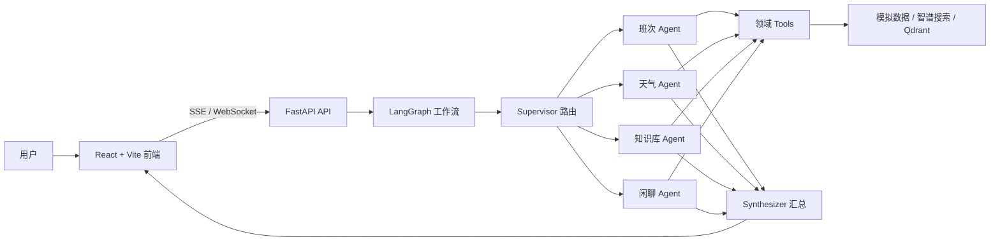
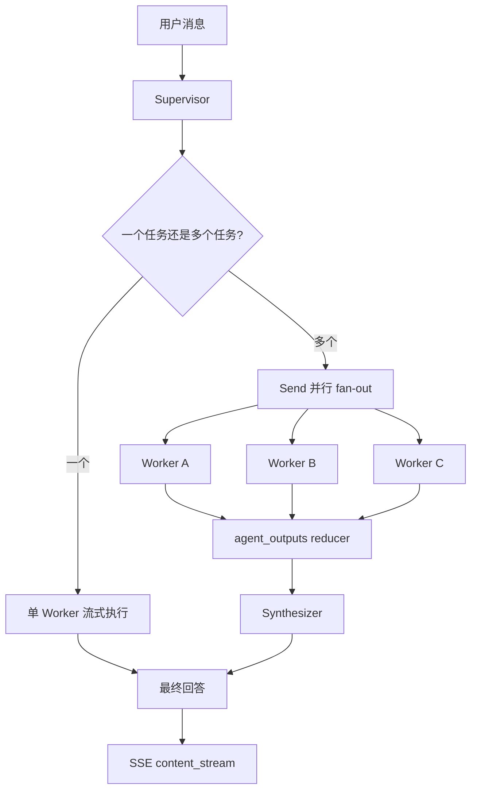
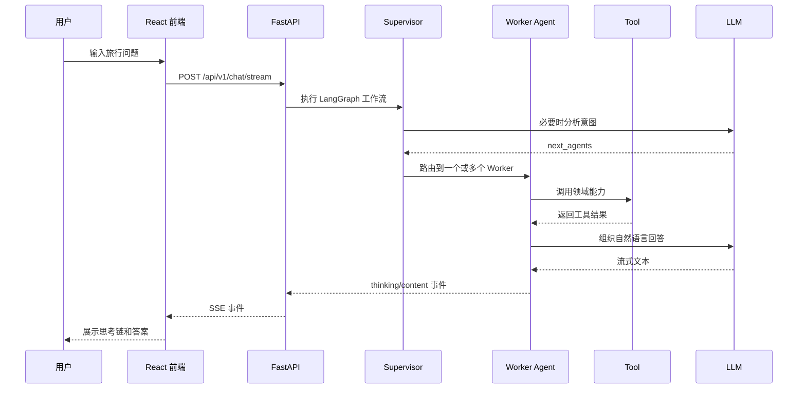
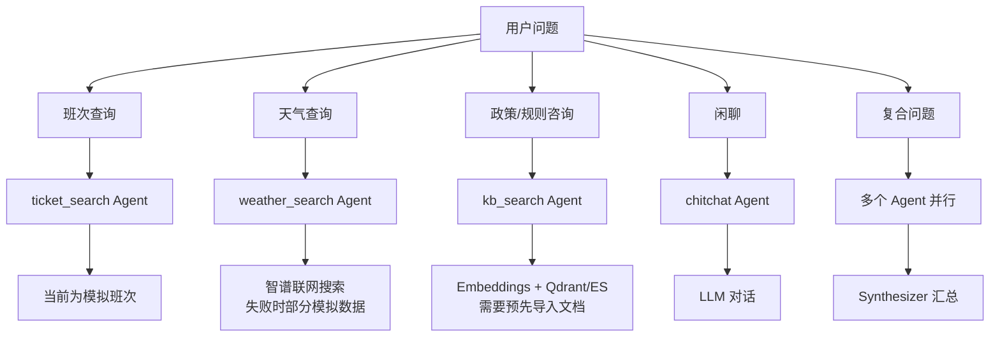
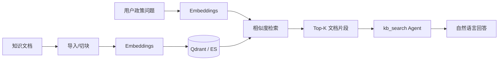

# planMultiAgent 多 Agent 旅行助手项目文档

本文档目录基于当前仓库代码整理，描述的是实际实现，而不是仅依据设计设想推断出的能力。

## 1. 项目定位

`planMultiAgent` 是一个基于 FastAPI、LangGraph、LangChain 和 React 的多 Agent 旅行助手。用户通过聊天输入需求，系统由 Supervisor 分析意图，再把任务路由给班次、天气、知识库或闲聊 Agent；多个任务可以并行执行，最后以 SSE 流式方式返回结果。

典型问题包括：

- 查询北京到上海的班次；
- 查询某个城市的天气；
- 咨询退票、改签和票价规则；
- 同时查询班次和天气；
- 进行旅行相关闲聊。

## 2. 文档索引

| 文档 | 内容 |
| --- | --- |
| [项目框架使用说明](./项目框架使用说明.md) | FastAPI、LangChain、LangGraph、Qdrant 和前端的实际代码落点 |
| [项目功能实现说明](./项目功能实现说明.md) | 各 Agent、工具、接口和当前功能边界 |
| [业务流程与数据流程说明](./业务流程与数据流程说明.md) | 用户请求从前端到 Supervisor、Worker 和结果汇总的完整链路 |
| [项目面试介绍与高频问答](./项目面试介绍与高频问答.md) | 项目介绍、技术取舍和常见追问 |

## 3. 系统总体框架



### 3.1 组件职责



## 4. 用户请求流程



## 5. 功能关系图



## 6. RAG 数据流程



> 当前仓库没有内置知识文档、导入脚本或文档上传接口，因此上图中的“导入/切块”是待补充的接入环节；现有代码已经实现查询侧和服务层写入方法。

## 7. 当前实现的重要边界

- LLM 是工作流运行的核心依赖，使用 OpenAI 兼容接口配置。
- Qdrant 和 Embeddings 只在知识库 Agent 实际初始化/检索时使用，不是普通聊天和班次模拟功能的必需依赖。
- 仓库没有内置知识文档，也没有对外暴露的文档导入接口；因此 RAG 代码是接入骨架，必须预先向配置的 collection 写入数据。
- 班次服务当前直接返回模拟数据，`TICKET_API_URL` 的真实请求代码仍被注释。
- 天气服务调用智谱联网搜索；没有有效 `ZHIPU_API_KEY` 时，代码包含部分城市的模拟天气降级。
- 会话使用 LangGraph `MemorySaver`，数据存储在当前进程内，服务重启后会丢失。

## 8. 快速启动

后端：

```powershell
cd backend
python -m pip install -r requirements.txt
python -m uvicorn app.main:app --host 0.0.0.0 --port 8002
```

前端：

```powershell
cd frontend
npm install
npm run dev -- --host 0.0.0.0 --port 5173
```

后端文档地址为 `http://localhost:8002/docs`，健康检查地址为 `http://localhost:8002/api/v1/health`。
