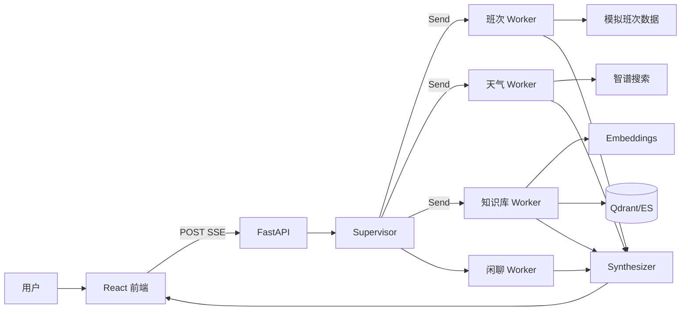
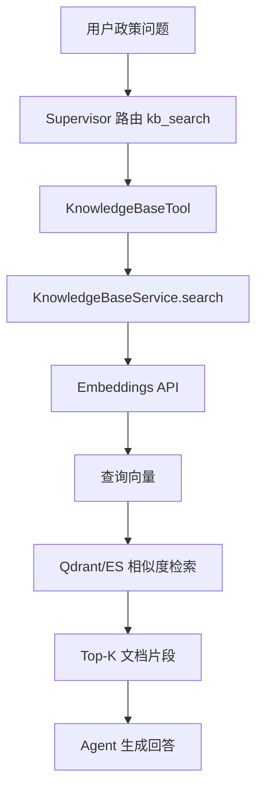

# planMultiAgent 业务流程与数据流程说明

> 本文档基于当前前端、后端和向量访问代码整理，重点说明请求如何流转，以及哪些能力仍是模拟或接入骨架。

## 1. 项目定位与总体架构

| 层次 | 模块 | 主要职责 |
| --- | --- | --- |
| 客户端 | React + TypeScript + Vite | 输入问题、展示消息、渲染思考链和流式答案 |
| API 层 | FastAPI | HTTP、SSE、WebSocket、CORS 和生命周期 |
| 编排层 | LangGraph | Supervisor 路由、Send 并行、状态聚合 |
| Agent 层 | ReAct Worker Agents | 使用 LLM 调用领域工具 |
| 工具层 | ticket、weather、kb、chitchat | 访问模拟服务、联网服务或向量库 |
| AI 层 | OpenAI 兼容 LLM、Embeddings | 意图分析、工具调用、回答生成、文本向量化 |
| 数据层 | MemorySaver、Qdrant/ES | 会话状态和可选知识库 |



## 2. 一次聊天请求的业务流程

1. 用户在前端输入消息。
2. 前端生成或复用 `session_id`，调用 `POST /api/v1/chat/stream`。
3. 后端先发送 `session_id` 和 `thinking_start`。
4. LangGraph 根据 `thread_id=session_id` 加载 MemorySaver 中的历史消息。
5. Supervisor 先关键词匹配，再按需要调用 LLM 分析意图。
6. Supervisor 返回一个或多个 `next_agents`。
7. 工作流把任务路由到对应 Worker。
8. Worker 调用自身绑定的 Tool，并由 LLM 组织结果。
9. 单任务直接流式返回；多任务先聚合，再交给 Synthesizer。
10. 后端发送 `thinking_end` 和 `response_end`。
11. 前端更新消息内容、思考链和会话状态。

## 3. 单任务流程

```text
用户问题
  -> Supervisor
  -> 一个 Worker Agent
  -> 一个 Tool
  -> Worker LLM 生成回答
  -> content_stream
  -> response_end
```

例如“北京天气怎么样”：

```text
weather 关键词
  -> weather_search Agent
  -> WeatherSearchTool
  -> Zhipu SearchService
  -> Agent 整理天气回答
```

## 4. 多任务并行流程

```text
“查北京到上海的高铁，并看看上海天气”
  -> Supervisor 识别 ticket_search + weather_search
  -> Send 分发两个 Worker
  -> TicketSearchTool 返回班次结果
  -> WeatherSearchTool 返回天气结果
  -> Synthesizer 汇总
  -> 流式返回综合回答
```

并行分支的结果通过 `AgentState.agent_outputs` reducer 聚合。一个分支失败时，工作流会记录该分支失败，并继续按工作流逻辑返回可用结果或错误提示。

## 5. 知识库/RAG 数据流程

当前代码中的 RAG 查询流程如下：



但“文档进入向量库”的流程目前不在仓库中：

```text
KnowledgeBaseService.add_document/add_documents
  -> 可将文本转向量并写入 collection
```

这两个方法只是服务层能力，没有对应的上传路由、命令行导入脚本或仓库内置文档。因此当前项目默认不会自动生成知识库数据。

### 5.1 无 Qdrant 时的实际行为

通常流程是：

1. Supervisor 仍然可以把问题路由到 `kb_search`；
2. KnowledgeBaseTool 初始化客户端；
3. 查询时 Embeddings 或 Qdrant 请求失败；
4. `KnowledgeBaseService.search()` 捕获异常并返回 `[]`；
5. KnowledgeBaseTool 进入“未找到相关信息”分支；
6. Agent 根据工具结果生成兜底回答。

所以“路由到知识库 Agent”不等于“成功检索到知识”。路由和基础设施可用性是两个不同问题。

## 6. 主要数据对象

| 对象 | 来源 | 用途 |
| --- | --- | --- |
| `ChatRequest` | 前端 JSON | 消息、会话 ID、思考链开关 |
| `AgentState` | LangGraph | 消息、任务、上下文和 Agent 输出 |
| `subtasks` | Supervisor | 要执行的 Agent、任务描述和参数 |
| `agent_outputs` | Worker reducer | 各 Worker 的结果和成功状态 |
| `content_stream` | Worker/Synthesizer | 前端流式文本 |
| Qdrant point | 知识库写入 | 向量、内容、标题、来源和 metadata |

## 7. 状态和持久化边界

- 会话状态：`MemorySaver`，只存在当前 Python 进程；
- 前端消息：保存在 React/Zustand 状态中；
- Qdrant/ES：只有配置并写入文档后才承载知识库数据；
- 没有用户认证和数据库持久化；
- 服务重启后 MemorySaver 中的会话不会保留。

## 8. 异常和降级

| 场景 | 当前行为 |
| --- | --- |
| LLM 不可用 | Worker/工作流记录异常并返回错误提示 |
| Qdrant 不可用 | 知识库 service 打印错误并返回空列表 |
| Embeddings 不可用 | 通常被知识库 service 转换为空列表 |
| 知识库无匹配 | Tool 返回“未找到相关信息” |
| 智谱搜索失败 | SearchService 使用部分城市模拟天气或失败提示 |
| 班次 API 未接入 | TicketService 返回固定模拟班次 |
| 客户端断开 | SSE 生成器检查断开并停止发送 |

