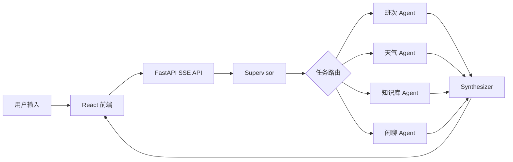

# planMultiAgent 项目功能实现说明

本文档按当前仓库中的实际代码说明功能，不把配置项或注释中的规划能力误认为已经完成的业务闭环。

## 1. 项目现状与整体链路

这是一个旅行场景的多 Agent 对话系统：



## 2. Supervisor 路由

Supervisor 位于 `backend/app/agents/nodes/supervisor.py`，采用两层策略：

1. 优先通过工具注册中心做关键词匹配；
2. 无匹配、或多个同优先级工具同时命中时，调用 LLM 做更精确的任务分析。

路由结果包含：

- `next_agents`：要执行的 Agent 名称；
- `subtasks`：任务描述和参数；
- `collaboration_mode`：单任务、并行或顺序；
- 各业务上下文字段。

例如“查北京到上海的高铁，顺便看看上海天气”可能路由到 `ticket_search` 和 `weather_search` 两个 Worker。

## 3. 四类 Worker Agent

### 3.1 班次 Agent

`TicketSearchTool` 接收出发地、目的地和日期。当前 `TicketService.search_tickets()` 直接调用 `_get_mock_data()`，返回固定的高铁、动车和大巴示例，因此目前不是实时车票查询。

虽然配置中存在 `TICKET_API_URL`，但真实 HTTP 请求代码仍被注释，不能把当前实现描述为已经接入真实票务系统。

### 3.2 天气 Agent

`WeatherSearchTool` 将城市拼接为“城市天气”，调用 `SearchService`。`SearchService` 使用智谱 AI 的 `web_search` 接口。

当智谱搜索失败时，服务层会对部分城市返回固定模拟天气；这属于开发降级数据，不代表实时天气。

### 3.3 知识库 Agent

`KnowledgeBaseTool` 调用 `KnowledgeBaseService.search()`：

```text
用户问题
  -> Embeddings 服务生成查询向量
  -> Qdrant/ES 相似度查询
  -> 返回 Top-K 文档片段
  -> KnowledgeBaseTool 格式化结果
  -> kb_search Agent 组织自然语言回答
```

当前仓库没有知识文档，也没有文档上传/导入 API。因此：

- 没有预先写入 collection 的文档时，检索不会产生有效知识内容；
- Qdrant 或 Embeddings 不可用时，`KnowledgeBaseService.search()` 会打印错误并返回空列表；
- `KnowledgeBaseTool` 随后通常进入“未找到相关信息”分支；
- 这会把“服务不可用”和“确实没有匹配文档”表现成相同结果，是当前实现的一个边界。

### 3.4 闲聊 Agent

`ChitchatTool` 负责问候、介绍能力和一般对话，不需要向量库。

## 4. 多 Agent 并行执行

`langgraph_workflow.py` 将每个 Worker 包装成主图节点：

- 单 Agent：使用 `astream_events` 流式转发回答；
- 多 Agent：并行执行多个 Worker，收集 `agent_outputs`；
- 多结果：交给 Synthesizer 使用 LLM 汇总；
- 单结果：可以直接透传，减少额外汇总调用。

主图使用 LangGraph `Send` 实现 fan-out，使用状态 reducer 聚合并行分支输出。

## 5. 会话和流式思考链

聊天接口根据 `session_id` 构造：

```python
config = {"configurable": {"thread_id": session_id}}
```

LangGraph `MemorySaver` 依据 `thread_id` 保存对话状态。它是进程内内存存储：

- 同一个进程内可以保留会话上下文；
- 服务重启后会话消失；
- 多进程或多实例部署时不能保证共享会话。

## 6. 当前接口

| 接口 | 实际功能 |
| --- | --- |
| `GET /api/v1/health` | 返回后端健康状态 |
| `GET /api/v1/test` | 简单测试 |
| `POST /api/v1/chat/stream` | SSE 流式聊天 |
| `WS /ws` | WebSocket 聊天 |

聊天响应事件由 `sse_event()` 统一封装，前端可以实时展示 Supervisor、Worker 和 Synthesizer 的过程。

## 7. 已实现与未实现边界

### 已实现

- Supervisor 关键词 + LLM 双层路由；
- 四类 Worker Agent；
- LangGraph 单任务和多任务并行；
- SSE 流式回答和思考事件；
- Qdrant/ES 访问器和 Embeddings 代理代码；
- 模拟班次查询；
- 智谱联网搜索天气；
- MemorySaver 会话状态。

### 尚未形成完整闭环

- 知识文档导入和切块流程；
- 知识库管理 API；
- 真实票务服务接入；
- 生产级持久化会话；
- 对 Qdrant 不可用与无检索结果的清晰错误区分；
- 生产环境的鉴权、限流、租户隔离和可观测性。

